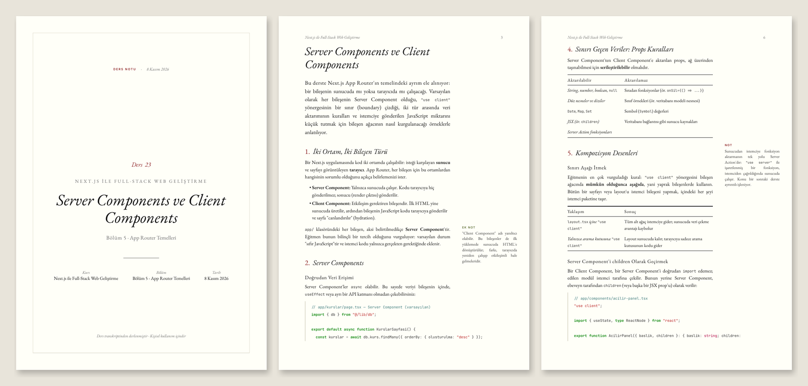

# Notlas

*not + atlas* — a Claude skill that turns course lecture transcripts (Udemy or any video course) into structured study notes. Each note is saved twice: as an academic-style **PDF** for reading and as **Markdown** in an indexed notes repository that AI agents can use as a knowledge source.

Notes are written in Turkish; technical terms keep their original English in parentheses, and code, commands and identifiers are never translated.



## How it works

1. You give Claude a transcript plus the course name and section/lecture titles (and optionally the course description).
2. Claude re-teaches the lecture as a Markdown note: summary, topic sections, runnable code, a concept table, pitfalls and review questions.
3. `scripts/save_note.py` validates the note, stores it in the repository, renders the PDF and rebuilds the indexes.

## Notes repository

```
courses/
├── README.md                             # all courses
└── <course-slug>/
    ├── INDEX.md                          # per lecture: summary, topics, concepts, file links
    ├── course.json                         # same data, machine-readable
    ├── notes/<NN-section>/<NNN-lecture>.md   # source for agents
    └── pdf/<NN-section>/<NNN-lecture>.pdf     # readable copy
```

To use a course as a knowledge source in another project, point the agent at the course's `INDEX.md`. It finds the relevant lecture there and opens only that Markdown file.

## Using it as a project folder

Clone the repo and open the folder in Claude Code or the Claude desktop app. `CLAUDE.md` describes the workflow:

```
notlas/
├── CLAUDE.md        # workflow instructions for Claude
├── SKILL.md         # note format and writing rules
├── transcripts/   # drop raw transcripts here (git-ignored)
└── courses/    # your notes repository (git-ignored)
```

## Installing the skill

**Claude app:** zip this folder without `.git/`, `courses/`, `transcripts/` and `docs/` (the command is in `CLAUDE.md`), or download `notlas.zip` from Releases, then go to **Customize → Skills → + → Create skill → Upload a skill**. Code execution and file creation must be enabled under Settings → Capabilities.

**Claude Code:** link (or clone) the folder into your personal skills directory:
```bash
ln -s ~/path/to/notlas ~/.claude/skills/notlas          # existing clone; edits apply immediately
git clone https://github.com/mrttyyldrm/notlas ~/.claude/skills/notlas   # or a fresh clone
```

## Usage

You don't need to remember a format:

- Type `/notlas` (or "notlas skill'ini kullan") on its own and Claude replies with a fill-in template that lists your courses and the last lecture saved in each.
- Paste a transcript without details and Claude asks once for whatever is missing (course, section, lecture), proposing the next lecture of the most likely course as the default.
- Drop `nextjs_05-23.vtt` into `transcripts/` and say "notlaştır": course, section and lecture number come from the file name.

Everything at once also works:

> Kurs: Docker ve Kubernetes
> Bölüm 2 - Depolama / Ders 7 - Docker Volume'ları
> *(transcript)*
> Bunu notlaştır.

## Scripts

```bash
pip install weasyprint markdown pygments
python3 scripts/clean_transcript.py lecture.vtt > lecture.txt          # VTT/SRT → plain text
python3 scripts/save_note.py note.md --root courses \
        --course-description "..."                                    # save: MD + PDF + indexes
python3 scripts/save_note.py --list-courses --root courses       # existing courses
python3 scripts/save_note.py --reindex --root courses [--prune]  # rebuild indexes from disk
python3 scripts/build_pdf.py note.md -o note.pdf                      # PDF only
```

`save_note.py` refuses misspelled section headings, course names that look like an existing course, and saves that would replace a different lecture; each check names the flag that overrides it. If PDF rendering fails, the note and indexes are still saved and a warning explains why.

PDF rendering uses WeasyPrint and falls back to an installed Chrome/Edge (on macOS, WeasyPrint needs `brew install pango`).

## Files

```
SKILL.md                    # instructions for Claude
CLAUDE.md                   # project-folder workflow
scripts/clean_transcript.py # strips timestamps and repeated caption lines
scripts/save_note.py        # validates and stores notes, builds INDEX.md / course.json / README.md
scripts/build_pdf.py        # Markdown → PDF
assets/themes/academic.css  # Tufte-style theme: ivory paper, EB Garamond, margin notes
assets/fonts/               # EB Garamond, Inter, JetBrains Mono (SIL OFL, full Turkish coverage)
docs/preview.png            # sample output shown above
CHANGELOG.md                # release notes
```

## Note

For personal use. Notes are derived from course content, so the copyright stays with the instructors. Don't publish your notes repository.
